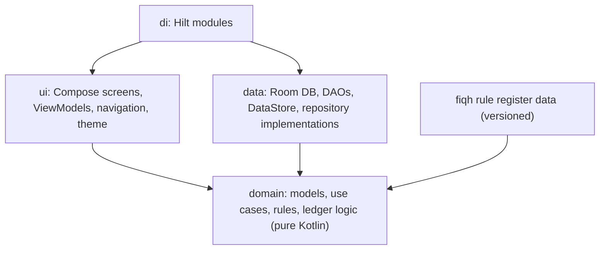

# Architecture Overview

Status: design (Phase 0). Nothing here is implemented yet.

## 1. Principles

- Offline-first: the local database is the system of record; no network is required for any feature.
- Domain logic is pure Kotlin and independently testable; Android is an implementation detail.
- Correctness-critical state (Qaza) is event-sourced (append-only ledger); everything else is conventional current-state plus revisions.
- Single Gradle module with strict package boundaries (ADR-0003). Multi-module is deferred until a measured need exists.

## 2. Layers



Dependency rule: `ui -> domain <- data`. `domain` imports nothing from Android, Room, Compose or Hilt annotations beyond plain `javax.inject` if needed. An architecture test (tool chosen in Phase 1) fails the build on violations.

## 3. Package layout (provisional)

```
com.muhammadtwaha.ibadahcompanion
  core/        Clock, IdGenerator, Result/error types, dispatchers
  domain/
    salah/     PrayerRecord, status rules, window rules
    sunnah/    SunnahRuleSet, VoluntaryPrayer
    qaza/      LedgerEntry, balance, plans, projection, use cases
    fasting/   FastRecord, Hijri abstraction, plans
    fiqh/      FiqhProfile, RuleRegister access
  data/
    db/        Room entities, DAOs, migrations, triggers, schema export
    repository/
    prefs/     DataStore
  ui/
    theme/ navigation/ components/
    home/ salah/ sunnah/ qaza/ fasting/ calendar/ history/ progress/ settings/ onboarding/
  di/
```

## 4. Key technical decisions (see ADRs)

| Topic | Decision | ADR |
| --- | --- | --- |
| Platform/UI | Kotlin, Compose, Material 3 | 0002 |
| Modules | One `app` module, package boundaries | 0003 |
| Persistence | Room over SQLite, offline only | 0004 |
| Qaza | Append-only ledger | 0005, 0006 |
| Fiqh | Profiles + versioned rule register | 0007 |
| Time | UTC instants + zone + local occurrence date | 0008 |
| Salah state | Stored states + derived `NEEDS_REVIEW` | 0009 |
| Identifiers | UUID + ledger `seq` | 0010 |
| CI | GitHub Actions as build environment | 0011 |
| Privacy | No network, no data in repo | 0012 |
| Hijri calendar | Pluggable calculation + user offset | 0013 |

## 5. State and data flow

Unidirectional: `Screen -> ViewModel (UiState via StateFlow, events in) -> UseCase -> Repository -> Room`. Reads are `Flow`; writes are suspend functions inside Room transactions. ViewModels never touch DAOs directly.

## 6. Transactions

Any operation that changes more than one table (for example daily-record revision + ledger entry) is a single Room `@Transaction` implemented in a repository or a dedicated transactional gateway, with the ledger invariants (L1-L10 in `qaza-accounting.md`) enforced again at the database layer by triggers.

## 7. Time and testability

All code obtains time and ids from injected `Clock` and `IdGenerator`. No direct `Instant.now()` or `UUID.randomUUID()` in domain or data code. This makes ledger and calendar behavior deterministic in tests.

## 8. Error model

Domain operations return typed results (success, or a sealed set of domain errors such as `InsufficientBalance`, `DuplicateRequest`, `InvalidReversal`). UI maps errors to calm, specific messages. Exceptions are for programmer errors and infrastructure failures only.

## 9. Prayer times and Hijri dates

Decided in Phases 2 and 5 respectively. Constraints now: computation must work offline; calculation method and Asr juristic setting are explicit user settings (FQ-005); the settings used are snapshotted on each record. A library versus in-house implementation is evaluated then, with versions verified from authoritative sources, not chosen here.

## 10. Localization and accessibility

String resources only (no hard-coded user text). English default; Roman Urdu as a Latin-script Urdu locale (resource qualifier and per-app language behavior to be verified in Phase 1). Layouts use start/end (not left/right) so Urdu-script RTL can be added later. All interactive elements have content descriptions; text scales with system settings.

## 11. Build configuration (proposed, confirm in Phase 1)

minSdk proposed at Android 8.0 (API 26) so `java.time` is available without desugaring; compileSdk/targetSdk set to the then-current stable level after checking official sources. Gradle Kotlin DSL with a version catalog; versions are resolved against official compatibility tables in Phase 1 and are **not** fixed in this document.

## 12. Out of scope here

Prayer-time algorithms, notification scheduling, backup crypto: each gets its own design note at its phase.
